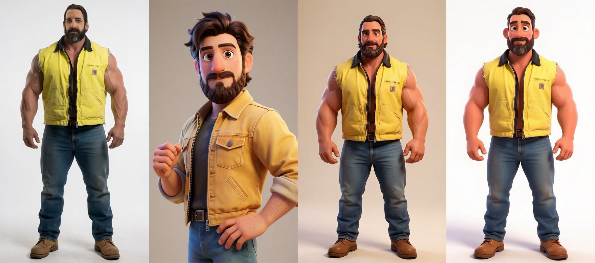
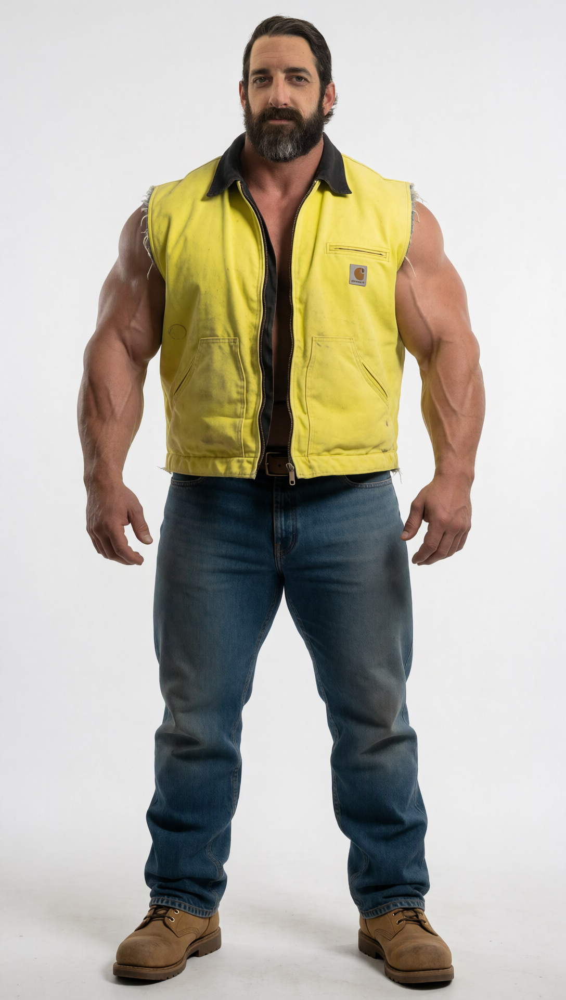
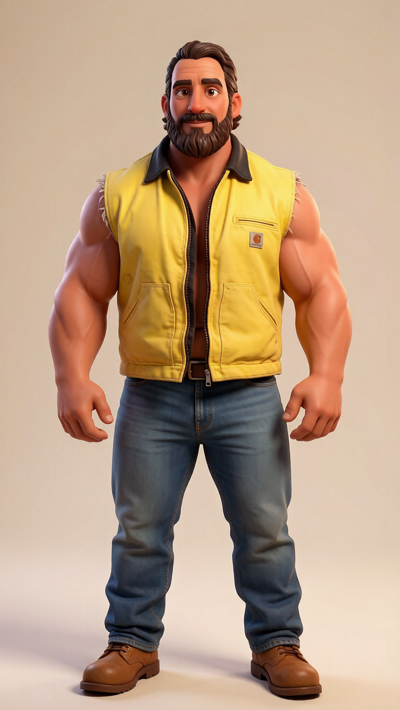

# HunyuanImage 3.0 — All-in-One ComfyUI Workflow

One ComfyUI workflow that covers every HunyuanImage-3.0 mode, controlled from a single panel:

- **Text → image**
- **Image editing** (restyle / transform an input image)
- **Multi-image fusion** (up to 3 input images)
- **Prompt rewriting** (the model expands your prompt first)
- **Spectrum** speed-up (~3.4× faster on the 50-step models)
- Works with all three models: **Instruct-Distil** (8 steps), **Instruct** and **Base** (text → image only)

Workflow file: [`workflow/HunyuanImage3_All-in-One.json`](workflow/HunyuanImage3_All-in-One.json)

It is built on [ComfyUI-HunyuanImage3](https://github.com/PedroMarinhoDev/ComfyUI-HunyuanImage3) by Pedro Marinho, which does the heavy lifting. This repo only packages the workflow around those nodes.

## Results

Edit mode, Instruct-Distil W4A8 (8 steps), output size taken from image 1.

| | Image | Notes |
|---|---|---|
| 1 |  | **Starting image** (image 1) |
| 2 |  | **Style reference** (image 2) |
| 3 |  | Image 1 restyled from the artwork in image 2. Prompt: `create the man from image 1 in the same artstyle as image 2` |
| 4 |  | Prompt only, no reference (*use image 2* off). Prompt: `Create the man as a pixar character` |

The two result PNGs still carry their ComfyUI metadata, so you can drag them into ComfyUI to load the exact settings.

## Requirements

- A recent ComfyUI. The workflow uses subgraphs and the core `ComfyMathExpression` node, so older builds will show missing nodes.
- Custom node pack: **[ComfyUI-HunyuanImage3](https://github.com/PedroMarinhoDev/ComfyUI-HunyuanImage3)** (install from ComfyUI-Manager or clone into `custom_nodes/`).
- Optional: [ComfyUI-Pixaroma](https://gitlab.com/pixaroma/ComfyUI-Pixaroma) for the small `PixaromaRunTimer` node. If you don't want it, delete that node, since nothing depends on it.
- Hardware, per the node pack: an NVIDIA GPU with 12 GB+ VRAM, and a lot of system RAM. ComfyUI holds about 50 GB with the W4A8 file loaded, so close other apps on a 64 GB machine. Allow about 45 GB of fast disk for the model.

## Model files

From Hugging Face (PedroMarinhoDev):

| File | Folder |
|---|---|
| `hunyuan_image_3_instruct_distil_w4a8.safetensors` | `models/diffusion_models` |
| `vae/hunyuan_image_3_vae_fp16.safetensors` | `models/vae` |
| `clip_vision/hunyuan_image_3_instruct_distil_siglip2_so400m_naflex.safetensors` | `models/clip_vision` |
| `hunyuan_image_3_instruct_distil_cot_head.safetensors` (prompt rewriting only) | `models/diffusion_models` |

Model repos: [Instruct-Distil](https://huggingface.co/PedroMarinhoDev/HunyuanImage-3.0-Instruct-Distil-ComfyUI) · [Instruct](https://huggingface.co/PedroMarinhoDev/HunyuanImage-3.0-Instruct-ComfyUI) · [Base](https://huggingface.co/PedroMarinhoDev/HunyuanImage-3.0-Base-ComfyUI)

The loader nodes in the JSON point at subfolders (`HunyuanImage3\…`, `hunyuanimage3\…`). If your files sit elsewhere, re-select them in the **① Models** group.

## How to use

1. Drag `workflow/HunyuanImage3_All-in-One.json` into ComfyUI.
2. **① Models:** pick your model, VAE and vision-tower files.
3. **④ Control Panel → Model type:** set it to match the model file (this sets steps and CFG for you).
4. **② Prompt:** type your prompt and press **Run**.
5. For editing, switch **Edit mode** on and load images in **③ Input images**. Refer to them in the prompt as "the first image", "the second image", and so on (or "image 1", "image 2").

### Control panel toggles

| Toggle | What it does |
|---|---|
| Edit mode | Off = text → image. On = edit / combine the images in ③ |
| Use image 2 / 3 | Add a 2nd / 3rd input image (edit mode) |
| Size from image 1 | Edit mode: keep image 1's shape. Off = use **Resolution** |
| Resolution | Size for text → image (trained at ~1 MP) |
| Prompt rewriting | Model expands your prompt first. Slow (~4–5 min extra) |
| Spectrum speed-up | ~3.4× faster for Instruct/Base, with some detail drift |
| Distil guidance | Distil only. Keep 2.5 |
| Steps override | 0 = automatic (8 / 50 / 50) |

### Tips

- Edit with a **different seed** than the one that made the input image.
- **Base** is text → image only (no edit, no rewrite).
- Want bigger output? Generate at ~1 MP, then upscale (SeedVR2 etc.).
- The image loaders in the JSON reference my own file names, so choose your own images in ③.

## Credits

- [HunyuanImage-3.0](https://huggingface.co/tencent/HunyuanImage-3.0) by Tencent Hunyuan.
- [ComfyUI-HunyuanImage3](https://github.com/PedroMarinhoDev/ComfyUI-HunyuanImage3) nodes, converted weights and reference workflows by Pedro Marinho. Check that repo and the Tencent license for terms of use of the model and nodes.
